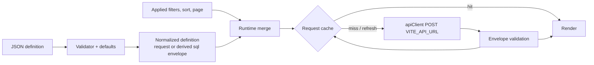

# Frontend architecture

The application is a configuration-driven React single-page app. At build time it discovers JSON definitions, then validates and normalizes them. At runtime it adds the user's filter, sort, and page state to a request, posts the request to one Generic SQL API endpoint, validates the response, and renders the rows.

## Startup and routing

`src/main.tsx` renders the providers in this order:

```text
SetupProvider            setup.status → loading | required | complete | error
└─ AuthProvider          auth.session (only once setup is complete)
   └─ GridProvider       shared AG Grid API reference (used by export)
      └─ FilterProvider  report filter state
         └─ AppRouter    BrowserRouter + routes
```

`src/router/AppRouter.tsx` decides what renders:

| Condition | Result |
| --- | --- |
| Setup check loading / failed | Loading screen / error with **Retry** |
| `setup.status` returns `initialized: false` | "User setup is required" screen for every path. Setup is completed in the Backend Admin Console, not in this app |
| No session | Redirect to `/login` |
| Signed in without `frontendAccess` | `/login` shows "Frontend access is not assigned" with **Sign out** |
| Signed in with `frontendAccess` | Protected routes below, inside `Layout` (sidebar + header) |

| Route | Page | Access |
| --- | --- | --- |
| `/` | Redirects to the first visible dashboard in `menu.json` (currently the Item Dashboard) | Signed in |
| `/dashboard/:dashboardId` | `DashboardViewer` → `Dashboard` | Signed in |
| `/report/:reportId` | `ReportViewer` | Signed in |
| `/settings` | `Settings` (shows User Management only to admins) | Signed in |
| `/settings/users` | `UserManagement` | `frontendRole: "application-administrator"` |
| `/login` | `Login` | Public |
| anything else | Redirects to `/` | — |

The protected `<Outlet>` is keyed by username. When a different user signs in, the page tree remounts, so no previous user's component state survives. See [Authentication](AUTHENTICATION.md).

## Configuration discovery

Vite `import.meta.glob` (eager) bundles these files into the build:

| Files | Loader | On an invalid file |
| --- | --- | --- |
| `src/config/reports/*.json` | `engine/ReportEngine/reportLoader.ts` → `ReportDefinitionEngine` | Logged; the report route shows the validation error |
| `src/config/dashboards/*.json` | `engine/DashboardEngine/dashboardLoader.ts` → `DashboardValidator.ts` | Logged; the dashboard renders its validation errors |
| `src/config/widgets/*.json` (none checked in) | `engine/WidgetEngine/widgetLoader.ts` | Logged and skipped; a `widgetId` that references it then fails dashboard validation |
| `src/config/menu.json` | `engine/NavigationEngine/loader.ts` | Throws at startup. Broken navigation stops the app |

Because the configuration is bundled, changing a JSON file requires a rebuild and redeploy. Nothing is loaded from the server at runtime. Reference: [Configuration](CONFIGURATION.md).

## Responsibility map

| Area | Responsibility |
| --- | --- |
| `src/config` | Reports, dashboards, menu, optional reusable widgets; `version.ts`, `frontendCapabilities.ts` |
| `engine/ReportDefinitionEngine` | Validates report/widget definitions, applies defaults, and derives the SQL Resource `execution` envelope |
| `engine/DashboardEngine`, `DashboardValidator.ts` | Validates dashboards; resolves inline, `reportId`, and `widgetId` widgets; merges shared filters; applies `filterFields` and `dateFilterBehavior` |
| `engine/FilterEngine`, `FilterQueryBuilder` | Validates filter definitions; converts applied values to API filters |
| `engine/ColumnEngine`, `GridEngine`, `ValueFormatter` | Column defaults, AG Grid options, sorting, display formatting |
| `engine/ExportEngine` | CSV/Excel writers, batched all-row fetch, export limits |
| `engine/RequestCache` | Response cache and in-flight deduplication |
| `engine/SavedReportEngine` | Per-user saved views in `localStorage` |
| `engine/*Context` | Dashboard, filter, and grid React contexts |
| `src/api` | The only `fetch` caller: credentials, CSRF, response validation, error normalization |
| `src/auth`, `src/setup` | Session, login/logout, user management services; setup-status gate |
| `src/pages`, `src/components` | UI state and rendering |

## Runtime data flow



**Reports** (`ReportViewer`):

1. Vite discovers the report file, and `ReportDefinitionEngine` validates it and applies defaults.
2. The base request receives the applied UI filters (appended to any static request filters), the current grid sort (replacing the configured initial `sort`), and `pagination` when grid paging is enabled.
3. The cache (`report:<reportId>` scope) supplies the response, or the request is sent.
4. The shared report/table frame, `GenericGrid`, pager, and toolbar render. Sorting returns to page 1. **Refresh** bypasses completed cache entries.

**Dashboards** (`Dashboard`): shared dashboard filters are merged into every widget definition. The widget's `filterFields` renames them where needed, and `dateFilterBehavior` decides whether widgets wait for a complete date range. Each widget then builds its own request and has independent loading, empty, error, and retry states (cache scope `dashboard:<dashboardId>:<widgetId>`). Details: [Dashboards and widgets](DASHBOARDS.md).

**Dynamic filter options** run their own JSON Query request (cache scope `dynamic-filter-options`), independent of the report or widget data request.

Every request is a JSON `POST` to `VITE_API_URL` with `credentials: "include"`. A successful read must contain `success`, `message`, an array of object rows in `data`, and valid `meta`. Anything else is reported as an unexpected response. See [API reference](API-REFERENCE.md).

## State boundaries

- Filter form (draft) state is separate from applied state. Only **Search** applies it.
- Sort and page state live in the report or widget component.
- Dashboard filters and the grid API use React contexts.
- Saved report views use `localStorage`, keyed per user. Sidebar collapse and group state also use `localStorage`.
- The request cache is in memory. A page reload or a change of user clears it.

## Error handling

`src/api/client.ts` throws `ApiClientError` (HTTP status, backend `code`, `details`) for backend failures, and plain `Error`s for malformed responses. `getRequestErrorMessage` (`src/api/request.ts`) turns these into user text: real network failures get a connectivity message, programming errors get a generic fallback, and backend validation details are appended as `path: message`. An intentional abort (navigation, unmount) is never shown as an error. A `401 AUTHENTICATION_REQUIRED` response signs the user out in this tab and notifies the other tabs.

## Ownership boundary

The browser always sends JSON. There are two configuration modes:

| Mode | The frontend defines | The backend owns |
| --- | --- | --- |
| JSON Query | Top-level `request` (`action: "select"`) with source, fields, and optional clauses, validated against the public SELECT allowlist | Authoritative validation, authorization, execution |
| SQL Resource | `queryDefinition: { format: "sql", resource: "widgets/…" }` plus top-level presentation | Resource discovery, SQL text, execution-metadata validation, parameter placement, credentials, execution |

Presentation stays in frontend JSON: columns, filter controls, grid, toolbar, export, dashboard layout, and widget rendering. For SQL Resources, the loader derives the constrained `execution` envelope from the top-level `columns` and `filters`. You don't write it, and it is never SQL. The frontend never locates, reads, parses, generates, or executes SQL, and it never sends SQL text. The former frontend SQL parser/converter was removed in `04573fb`. Do not reintroduce it. Full rules: [Query modes](QUERY-MODES.md).

## Build output

`npm run build` runs `tsc -b`, then `vite build`, into `dist/`, with no source maps. `index.html` references root-absolute `/assets/…` and `/favicon.svg`. In production mode, `vite.config.ts` refuses to build if `VITE_API_URL` is a loopback, invalid, or non-http(s) URL (`tooling/productionApiUrl.ts`). Hosting requirements: [Deployment](DEPLOYMENT.md).

## Design decisions and limitations

- **Bundled configuration**: definitions are validated at build/load time and deployed together with the code. The trade-off is that a configuration change needs a rebuild.
- **One endpoint, action-based API**: every read, auth, and admin call is a `POST` to the same URL, distinguished by `action`.
- **Backend is the authority**: frontend validation exists to give fast feedback to definition authors. Hiding a route or control is not a security boundary, because the backend authorizes every request.
- **Root hosting only**: there is no Vite `base` and no router `basename`.
- **Single chunk**: there is no code splitting yet, so the bundle is about 1.8 MB.

See [Configuration reference](CONFIGURATION.md), [Query modes](QUERY-MODES.md), and [Feature behavior](FEATURES.md).
